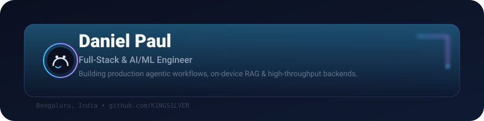
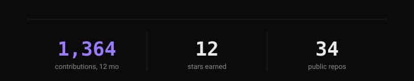
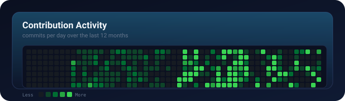
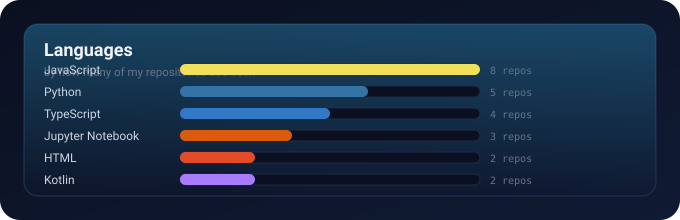

  
  
  
  

## About

Full-stack and AI/ML engineer who likes the unglamorous part of the stack: queues that do not drop work, graphs that finish early, and retrieval that runs on the laptop instead of someone else's API.

Currently finishing my Master of Computer Applications (MCA) at Christ University, Bengaluru, after a stint as a Technical Consultant Intern at Adobe Consulting Services.

**Quick facts**

| | |
|---|---|
| Location | Bengaluru, India |
| Focus | Agentic workflows, local-first RAG, high-throughput backends |
| Currently | Shipping FinPath at Adobe ACS, maintaining `teacher-sab` on npm |
| Interests | Systems programming, distributed systems, developer tooling |

---

### 🚀 Systems & Value Delivered

#### 🔹 Enterprise AI Workflows (Adobe ACS, FinPath)
* **Problem**: Enterprise financial planning workflows suffered from slow sequential tool execution and high latency.
* **Impact**: Reduced planning latency by **60%** via async **LangGraph** graph execution and Pydantic tool schemas.
* **Tech**: FastAPI, LangGraph, Supabase, PostgreSQL RLS, React 19

---

#### 🔹 Local-First Agentic RAG ([docSeek](https://github.com/K1NGS1LVER/docSeek-offline-agentic-RAG))
* **Problem**: Data privacy concerns and API costs block enterprise adoption of cloud RAG systems.
* **Impact**: 100% offline Corrective RAG with **sub-15ms search** across 10,000+ indexed pages.
* **Tech**: LangGraph, FAISS (768-dim), SQLite FTS5, Ollama, Kokoro TTS

---

#### 🔹 Narrative Intelligence Platform ([ClearNews](https://github.com/K1NGS1LVER/ClearNews))
* **Problem**: Ungrounded LLM summaries obscure news narrative drift over time.
* **Impact**: Fused fine-tuned **BERT** bias classification with **HDBSCAN/UMAP** clustering over 1,000+ daily articles.
* **Tech**: BERT, XGBoost, SHAP, pgvector, LangGraph, FastAPI, Redis

---

#### 🔹 Open-Source CLI ([`teacher-sab`](https://github.com/K1NGS1LVER/teacher_sab), npm)
* **Problem**: Cross-agent skill installation friction across AI harness ecosystems.
* **Impact**: Published a zero-dependency CLI supporting 10 AI harnesses with byte-identical skill distribution.
* **Tech**: Node.js, npm registry, YAML parser, E2E testing

---

### 🛠️ Core Engineering Stack

  

| Area | Tools |
|---|---|
| AI / ML | LangGraph, RAG/CRAG, BERT, XGBoost, SHAP, FAISS, pgvector, Ollama, PyTorch |
| Backend | Python, FastAPI, Node.js, PostgreSQL, Supabase, Redis, Docker |
| Frontend | TypeScript, React 19, Tailwind CSS, Vite |
| Systems | C, Go, SQLite, Linux |
